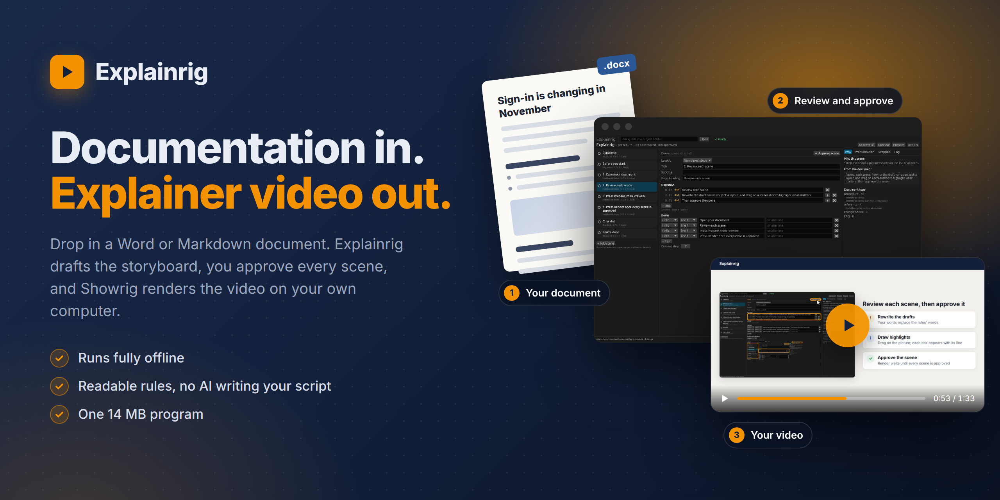
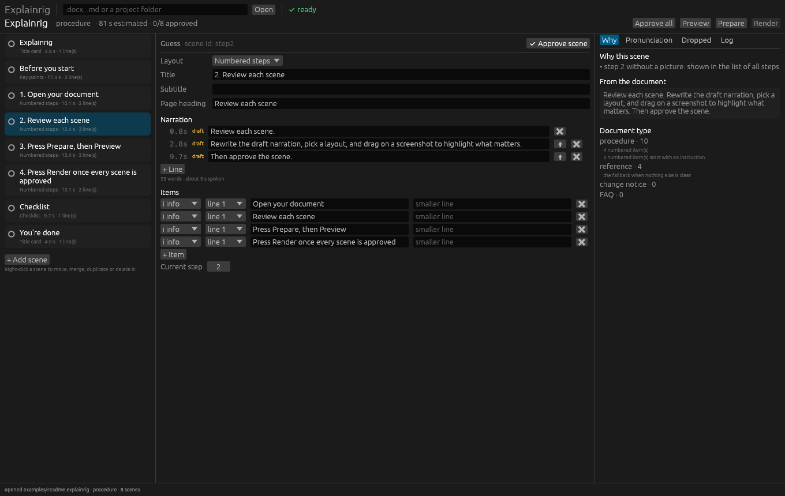
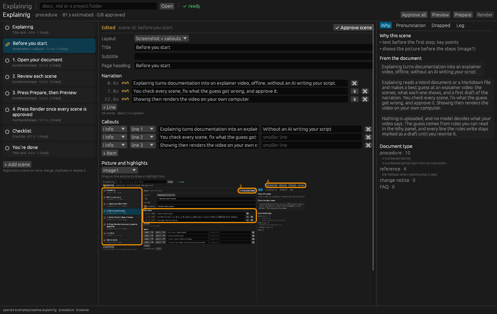
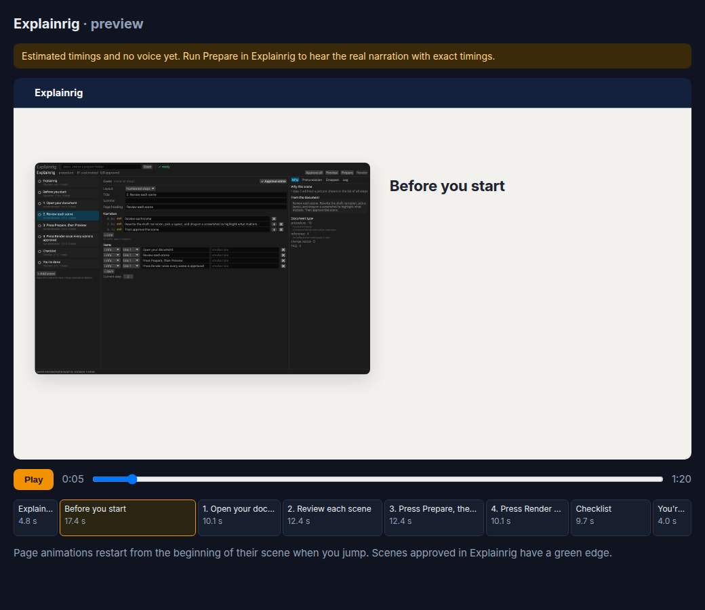

# Explainrig



Explainrig turns documentation into an explainer video, offline, without an AI writing your script.

Explainrig reads a Word document or a Markdown file and makes a best guess at an explainer video: the scenes, what each one shows, and a first draft of the narration. You check every scene, fix what the guess got wrong, and approve it. Showrig then renders the video on your own computer.

Nothing is uploaded, and no model decides what your video says. The guess comes from rules you can read in the Why panel, and every line the rules write stays marked as a draft until you rewrite it.



`examples/readme.explainrig` is the project behind Explainrig's video of itself, made from this README. Open it with `explainrig examples/readme.explainrig`.

## Make a video

1. Open your document. Drop a .docx or .md file on the window, or type its path and press Open.
2. Review each scene. Rewrite the draft narration, pick a layout, and drag on a screenshot to highlight what matters. Then approve the scene.

   

3. Press Prepare, then Preview. Showrig records the voice and measures every line, and the preview plays your film as a timed slideshow in your browser.

   

4. Press Render once every scene is approved. Showrig builds the final video, and Explainrig tells you where it is.

## What you need

- [Showrig](https://github.com/tweakyourpc/showrig) 0.3 with its capture and voice setup. Explainrig checks for it and tells you what is missing. It never installs anything itself.
- Linux. Other platforms come later.
- For a computer with no internet connection, set Showrig up while it is still online. Showrig's offline kit does not include its capture and voice setup yet. After that, copy the `explainrig` program (one file) and your projects across.

Run `explainrig doctor` to see what is ready.

## How the guess works

- **Sections** come from headings. When a document has none, bold list items and bold lines such as "Background:" mark them instead.
- **The document type** is scored from what is in it: dates and change words for a change notice, numbered instructions for a procedure, questions for an FAQ. The Why panel shows the scores.
- **Each type has a recipe.** A change notice gets a timeline, one scene per group of readers, and a call to action. A procedure gets one scene per step and a checklist.
- **Narration drafts** are the document's own sentences, rewritten into the second person ("Users with X are already set up" becomes "If you already use X, you're all set").
- **Pronunciations** spell out acronyms, read web addresses with "dot", and expand short month names. You can change any of them.
- **Left-out sections** such as Background and Purpose wait in the Dropped panel, ready to restore.

## Commands

Everything the window does is also a command. `explainrig help` lists them all:

```text
explainrig [DOC|PROJECT]        open the review window
explainrig doctor               check Showrig and its capture and voice setup
explainrig import DOC           make a project from the rules' best guess
explainrig show PROJECT         the storyboard as text
explainrig approve PROJECT      approve scenes (--all for every scene)
explainrig prepare PROJECT      voice and exact timings, then a timed preview
explainrig render PROJECT       the final video
explainrig auto DOC             import, approve, prepare and render in one go
```

Build commands come from `~/.config/explainrig/config.json`, so a machine that renders on another computer only needs different commands. `contrib/srw-runner.sh` is an example that renders on a Showrig worker over SSH.

## A project folder

```text
NAME.explainrig/
  explainrig.json   the storyboard, your edits and approvals
  img/              pictures taken from the document
  timing.json       measured line times from the last prepare
  film/             the Showrig film folder, with preview.html
```

## Building

Explainrig is a Rust workspace. Build it with `cargo build --release`; the program is `target/release/explainrig`.

| Crate | Job |
|---|---|
| `crates/doc` | reads .docx and Markdown into ordered blocks |
| `crates/guess` | the rules: sections, document type, recipes, drafts, pronunciations |
| `crates/film` | writes the Showrig storyboard, the animated pages and the preview |
| `crates/runner` | checks prerequisites and runs Showrig |
| `apps/explainrig` | the window and the commands |

The test documents in `tests/fixtures` are made by `tests/fixtures/make_fixtures.py`.

## License

MIT. Copyright (c) 2026 Christopher Davis.
